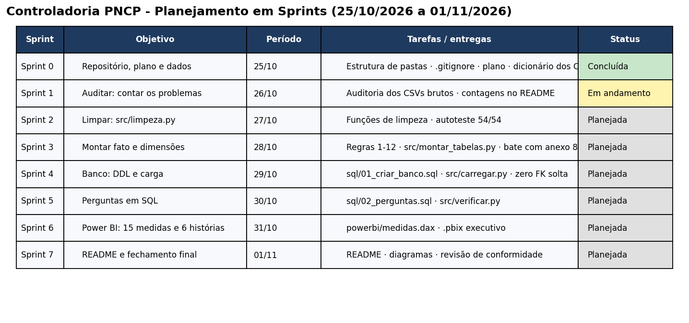
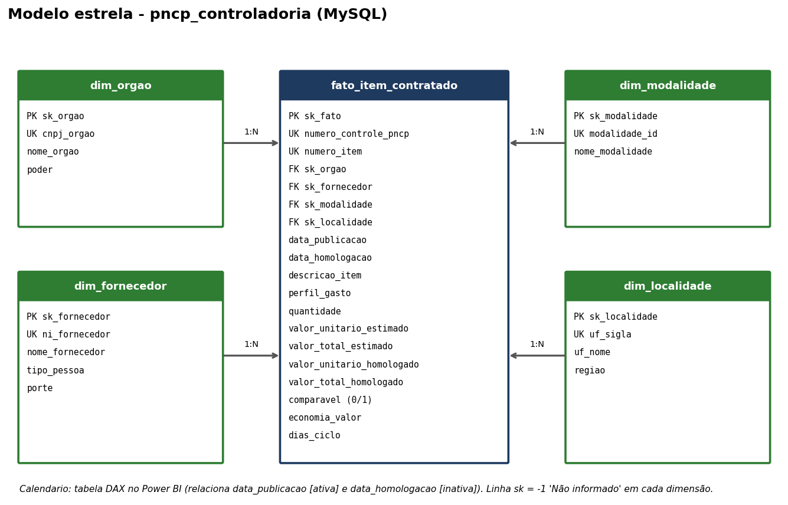

# Controladoria PNCP – Esteira analítica de compras públicas federais

Projeto avaliativo do Módulo 2 (Análise de Dados com Python – MySQL, T2). Autor: **Rafael Engels**.

Pipeline ponta a ponta: **PNCP (CSV brutos) → Python/pandas (auditoria + limpeza) → MySQL (Star Schema) → Power BI (dashboard executivo)**.

## 1. Contexto

A Controladoria federal não confia nos relatórios feitos a partir do repositório bruto de contratações do PNCP (2025, 12 meses). Os dados chegam com CNPJ mascarado e sem zeros à esquerda, dinheiro em texto (`R$ 1.234,56`), seis formatos de data, nulos disfarçados (`N/A`, `-`, `0`), acentos quebrados e resultados cancelados/duplicados por Registro de Preços. O projeto transforma esse material em um ambiente analítico auditável que responde a 6 perguntas de negócio:

| # | Tema | Pergunta |
|---|---|---|
| 1 | Economia | Quanto (R$ e %) o governo economizou (estimado − homologado)? |
| 2 | Fornecedores | Quem concentra o orçamento? É um risco? |
| 3 | Modalidades | Qual economiza mais e qual movimenta mais dinheiro? |
| 4 | Ciclo | Quantos dias entre publicação e homologação, por órgão? |
| 5 | Regional | Onde se gasta mais e onde há mais desconto? |
| 6 | Perfil | Bens, serviços ou obras e engenharia? |

## 2. Estrutura do repositório

```
data/raw/            CSVs brutos do professor (compras, itens, resultados)
data/processed/      saída do pipeline (ignorada pelo Git; regenerável)
src/                 limpeza.py · montar_tabelas.py · carregar.py · banco.py · config.py · auditar.py · verificar.py
sql/                 01_criar_banco.sql (DDL) · 02_perguntas.sql (6 perguntas)
powerbi/             medidas.dax · controladoria_pncp.pbix
docs/                img/ (sprints.png, modelo_estrela.png)
scripts/             executar_tudo.bat
```

## 3. Sprints



## 4. Decisões técnicas e por quê

| Decisão | Motivo |
|---|---|
| Ler tudo com `dtype=str` | Evita perder zero à esquerda do CNPJ e NaN automático. Converte-se só nas funções de `limpeza.py`. |
| Tipo de pessoa define o tamanho do documento (PJ 14, PF 11, PE intacto) | Recupera zeros perdidos; mais dígitos que o tamanho → documento impossível → `NULL`. |
| Separador sozinho (`.` ou `,`) = decimal; repetido = milhar; ambos = o último é decimal | Regra da base (`746.815` = 746,815). Evita volume de R$ 31 bi em vez de R$ 8 bi. |
| `"0"` é nulo só em texto; em números é valor | Quantidade/valor zero precisa ser rejeitado por regra, não sumir como nulo. |
| Descartar cancelados **antes** de escolher o 1º colocado | Se o 1º está cancelado, o 2º assume (regra 2). Inverter a ordem perde ~60 itens. |
| Desempate pelo menor `sequencial_resultado` numérico | `2` vem antes de `10` (Credenciamento tem ordem vazia). |
| Rejeição de itens após calcular valores | 99 itens rejeitados (qtd ≤ 0, unitários ≤ 0, sigiloso, total estimado < R$ 1, homologado > 1000× estimado, > R$ 1 tri). Não são carregados. |
| Comparável = não-Credenciamento **e** razão homologado/estimado em [0,1; 10] | Credenciamento tem teto global como estimado; razões absurdas distorcem a economia. |
| Economia % = Σ economia ÷ Σ estimado comparável | Nunca média de percentuais. |
| Homologação anterior à publicação → data e ciclo `NULL`, item permanece | Cronologia impossível, mas o gasto existe. |
| Obras: `\b(OBRAS?\|CONSTRUÇÃO\|CONSTRUCAO\|REFORMA\|ENGENHARIA)\b` em descrição + objeto | Palavra inteira (`\b`) evita "cobrança"/"dobradiça". Obras tem prioridade sobre Material/Serviço. |
| Star Schema com `sk_` INT e UNIQUE na chave natural | Atende integridade; o `sk = -1` ("Não informado") existe em cada dimensão para FK sem dado. |
| `CHECK` e `DECIMAL(18,2/4)` | O banco é a 2ª barreira (quantidade > 0, valores ≥ 0, `comparavel` ∈ {0,1}). |
| Carga em lote (1.000 linhas), dimensões antes da fato, validação de FK solta | Rápido, respeita FKs e termina com erro claro (exit 1) se algo falhar. |

Discordâncias com as regras: nenhuma.

## 5. Dicionário de inconsistências tratadas

Contagens auditadas via `python -m src.auditar` diretamente sobre a base bruta.

| Desafio | Exemplos encontrados | Tratamento |
|---|---|---|
| 1. CNPJ/CPF | máscara em 176 órgãos e 1.633 fornecedores; 77 CNPJs de órgão sem zero | `limpar_documento` |
| 2. Dinheiro/decimais | `R$`, vírgula, ponto como decimal, milhar repetido, parênteses/negativos | `converter_numero` |
| 3. Datas | 7 máscaras no mesmo campo; 234 resultados com homologação antes da publicação | `converter_data`; regra 7 anula |
| 4. Nulos disfarçados | `N/A`, `-`, `NULL`, `SEM INFORMAÇÃO`, `0` em texto | `eh_nulo` / `limpar_texto` |
| 5. Encoding e nomes | `ç`, `ã`; 440 nomes de órgão → 352 padronizados; 539 CNPJs → 370 | `consertar_acento`, `padronizar_nome` |
| SRP | 62 resultados cancelados; vários classificados por item | regra 2 |
| Sigilosos | 54 itens com orçamento sigiloso | rejeitados |

## 6. Modelo dimensional



| Tabela | Linhas |
|---|---:|
| `fato_item_contratado` | 6.126 |
| `dim_orgao` | 363 |
| `dim_fornecedor` | 2.652 |
| `dim_modalidade` | 7 |
| `dim_localidade` | 27 |

Mais uma linha `sk = -1` em cada dimensão. O tempo é a tabela `Calendario` criada em DAX.

## 7. Prova real (anexo 8)

`python -m src.verificar` confere o **banco** contra o enunciado: fato 6.126 · 1.962 contratações · volume R$ 8.044.498.805,74 · estimado comparável R$ 6.867.663.469,91 · 5.457 comparáveis · economia R$ 992.861.686,95 (**14,46%**) · 27 itens com sobrepreço · ciclo médio **48,1** dias, máximo **611**, 5.896 com ciclo, 230 sem ciclo · perfil Obras 60,8% / Serviços 36,6% / Bens 2,6%. Todos conferem.

Respostas obtidas (arquivo `sql/02_perguntas.sql`):

1. Economia de **R$ 992,86 mi = 14,46%** sobre o estimado comparável (5.457 de 6.126 itens comparáveis).
2. Maior fornecedor: Now Seguros S.A. (13,18% do volume). Top 10 concentram **41,43%**.
3. Maior desconto: Pregão Eletrônico (24,02%). Maior volume: Concorrência Eletrônica (58,43%). Credenciamento (26,62% do volume) não tem economia calculável.
4. Ciclo médio geral 48,1 dias; maior média por órgão (≥ 5 itens): UFCG, 266,3 dias.
5. Centro-Oeste concentra 44,25% do volume (DF R$ 3,14 bi); melhor desconto regional: Norte (21,43%).
6. Obras e engenharia 60,8% · Serviços 36,6% · Bens 2,6%.

## 8. Tecnologias

Python 3.13 · pandas · mysql-connector-python · MySQL 8 · Power BI Desktop + DAX · Git/GitHub.

## 9. Como reproduzir do zero

1. Instalar Python 3.10+, MySQL 8 e Git. No MySQL, o usuário e senha do `.env` precisam existir.
2. `git clone https://github.com/R-Engels/RAFAEL_ENGELS_Dados_T2-SEMANA-13.git` e `cd RAFAEL_ENGELS_Dados_T2-SEMANA-13`.
3. Copiar `.env.example` para `.env` e preencher `MYSQL_PASSWORD` (o `.env` nunca vai para o Git).
4. Rodar `scripts\executar_tudo.bat`. Ele executa, em ordem:
   ```
   pip install -r requirements.txt
   python -m src.limpeza          # autoteste: 54 de 54
   python -m src.montar_tabelas   # grava data/processed/*.csv
   python -m src.carregar         # cria o banco, carrega, confere contagens e FK
   python -m src.verificar        # prova real + 6 perguntas
   ```
5. Abrir `powerbi/controladoria_pncp.pbix` (requer driver MySQL Connector/NET 8.x) e clicar em **Atualizar**.

## 10. Power BI

15 medidas obrigatórias + extras em [`powerbi/medidas.dax`](powerbi/medidas.dax), tabela `Calendario` dinâmica em DAX com ordenação numérica de meses, uma página executiva por pergunta de negócio (pergunta → números/KPIs → gráficos ordenados por Pareto → conclusão executiva), seguindo os princípios de design CRAP.

## 11. Melhorias futuras

- Agendar a carga (Airflow/Task Scheduler) e ingerir a API do PNCP direto.
- Separar serviços continuados de eventuais no perfil do gasto.
- Dimensão de unidade de medida e catálogo de itens para comparar preços unitários entre órgãos.
- Detecção de sobrepreço por mediana do item no catálogo.
- Pipeline de integração contínua (GitHub Actions + validação da esteira).

## 12. Vídeo (Review de Sprint)

Link: _a ser inserido após a gravação._
